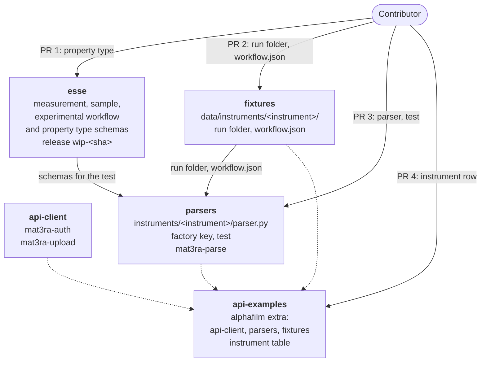
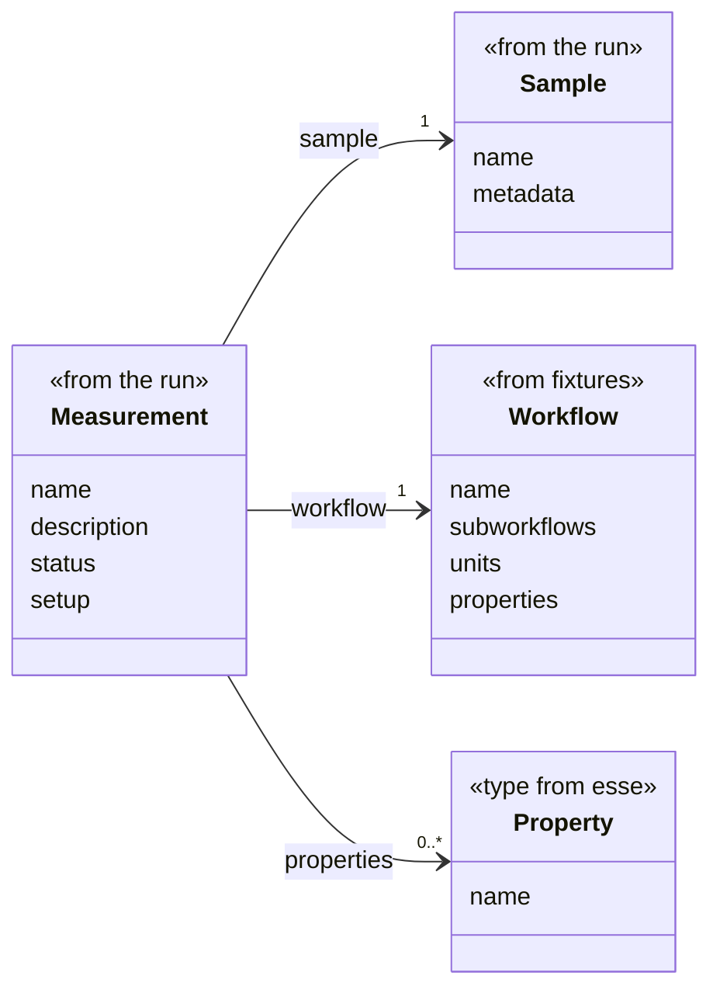

---
tags:
  - alphafilm
  - experimental-data
  - contribution
hide:
  - tags
render_macros: true
---

# Contribute Experimental Data Types

!!!abstract "TL;DR"
    Adding a new instrument, or a new type of result, is a sequence of pull requests (PRs), each against the
    `alphafilm` branch of its repository and merged in this order:

    1. **Define the Property Type:** only for a type of result that esse does not define yet. Add its schema to
    [esse](https://github.com/mat3ra/esse) and publish a work-in-progress release, which the web application of the
    platform pins.

    2. **Add the Sample Data:** add a run folder of the instrument's output and the `workflow.json` of its
    measurements to [fixtures](https://github.com/mat3ra/fixtures), and register both in the package manifest.

    3. **Write the Parser:** add the parser, its factory key and its test to
    [parsers](https://github.com/mat3ra/parsers).

    4. **List the Instrument:** add the instrument's row to the README of
    [api-examples](https://github.com/mat3ra/api-examples), whose `alphafilm` extra installs api-client, parsers and
    fixtures in one command, and to the instrument table of the documentation.

This page explains how a new instrument, or a new type of result, is added to the tools that turn an instrument's
output into measurements: the schemas in esse, the sample data in fixtures, the parser in parsers, and the
installation in api-examples. Once the pull requests are merged, `mat3ra-parse` writes the new instrument's runs as
measurements.

The task involves pull requests to the repositories described below and to the documentation. A GitHub account, git
with git-lfs, its Git Large File Storage (LFS) extension, Python 3.10 or newer, and [Node.js](https://nodejs.org) for
the esse tests are required, together with a run of the new instrument as the instrument delivered it.


## 1. Overview

### 1.1. Understand the repository architecture

Five repositories are involved. Each one that changes gets a pull request:

[**esse**](https://github.com/mat3ra/esse) holds the JavaScript Object Notation (JSON) schemas of the records: the
experimental workflow, the measurement, the sample and the property types. The platform and the tests of parsers
validate measurements against them.

[**fixtures**](https://github.com/mat3ra/fixtures) holds, for each instrument, a sample of its delivered output, a run
folder, and the `workflow.json` of its measurements.

[**parsers**](https://github.com/mat3ra/parsers) holds one parser per instrument and the command `mat3ra-parse`, which
runs the parser of an instrument on a run folder and writes the measurements, each with the instrument's
`workflow.json` from fixtures.

[**api-client**](https://github.com/mat3ra/api-client) provides the commands `mat3ra-auth` and `mat3ra-upload`. It
needs no change for a new instrument.

[**api-examples**](https://github.com/mat3ra/api-examples) holds the installation. Its `alphafilm` extra installs
api-client, parsers and fixtures as one install, and its `examples/measurement/README.md` lists the instruments.

The repositories are coupled by the instrument's name. The workflow names the instrument on its subworkflow, such as
`xrf-instrument`. The same name, with underscores for hyphens, is the folder `data/instruments/xrf_instrument/` and the
key `instruments.xrf_instrument` in fixtures, and the folder `instruments/xrf_instrument/` and the factory key
`instruments.xrf_instrument` in parsers. On the command line the name keeps its hyphens: `mat3ra-parse xrf-instrument`
reads the workflow under that key in fixtures and runs the parser registered under the name the workflow gives.

The result names in the workflow, in its `properties` and in each unit's `results`, follow the esse property types. A
result whose type esse defines, such as `hysteresis_loop`, becomes a property of the measurement. A result whose type
esse does not define yet, such as `iv_curve`, stays in the measurement's files.

The repositories share a branch, `alphafilm`. The `alphafilm` extra of api-examples installs api-client, parsers and
fixtures from their `alphafilm` branches, and the `tests` extra of parsers installs esse and fixtures from theirs. The
platform takes esse from a work-in-progress release instead: a commit with `[release]` in its message publishes the
release `wip-<short sha>`, and the web application pins it. As a result, the pull requests are merged in order: esse
first, when there is a new property type, then fixtures, parsers, api-examples and documentation.



### 1.2. Understand the data

Every measurement carries the workflow of its instrument: what is measured, with which instrument, and with which
results. The workflow follows the [experimental workflow]({{ schemas_url }}/#schema/workflow/experimental.json)
schema. The instrument is named once, on the subworkflow. Each unit has the type `measurement` and lists its results.
esse's `example/workflow/experimental.json` is the workflow of a switching spectroscopy piezoresponse force
microscopy (SS-PFM) run, here with cuts marked `"...": "..."`:

```json
{
    "name": "SS-PFM Hysteresis Loop",
    "subworkflows": [
        {
            "name": "ss_pfm",
            "instrument": {
                "name": "asylum-spm",
                "shortName": "spm",
                "summary": "Asylum Research SPM driven by afm-lib (switching-spectroscopy PFM)",
                "version": "1.0"
            },
            "properties": [
                "hysteresis_loop"
            ],
            "units": [
                {
                    "type": "measurement",
                    "name": "run_loop",
                    "head": true,
                    "results": [
                        {
                            "name": "hysteresis_loop"
                        }
                    ],
                    "...": "..."
                }
            ],
            "...": "..."
        }
    ],
    "units": [
        {
            "type": "subworkflow",
            "name": "ss_pfm",
            "...": "..."
        }
    ],
    "properties": [
        "hysteresis_loop"
    ],
    "tags": [
        "experimental",
        "afm"
    ],
    "...": "..."
}
```

A parser turns one run into a folder. `set.json` holds the run's name, description and metadata, and each measurement
gets a subfolder with its `measurement.json` and its own files under `files/`. `measurement.json` follows the
[Measurement]({{ schemas_url }}/#schema/measurement.json) schema, with the sample itself under `sample` in place of the
reference `_sample`. Its parts come from three places:



The run gives the measurement's name and `setup`, its sample and its files. The parser decides what one measurement
is, such as one site or one pad, and gives it one sample with a `name` and, when the data gives one, a position in
`metadata` as `{"coordinates": [x, y], "units": …}`. A `sample.json` in the run folder adds its content to every
sample's `metadata`. `setup` holds the instrument's record of the run, such as its settings. Each measurement gets only
its own files, copied as delivered, or the header and its own row of a table.

The `workflow` is the instrument's `workflow.json` from fixtures, the same for every measurement of the run. A parser
may add the run's procedure to its `metadata`, as the parser of `asylum-spm` does with the point pattern of each pad.

Each entry of `properties` is a result of a type that esse defines, in the shape of that type's schema, such as
[Hysteresis loop]({{ schemas_url }}/#schema/properties_directory/non_scalar/hysteresis_loop.json). Other results stay
in the files.


## 2. `esse` repository

!!!info
    This section is needed only for a new property type. A new instrument needs no schema change: its name is a
    value in the workflow.

### 2.1. Fork and clone the repository

First, fork [github.com/mat3ra/esse](https://github.com/mat3ra/esse) on GitHub with all its branches, so that the
fork has `alphafilm`. Then clone the fork at that branch:

```bash
git clone -b alphafilm https://github.com/<user>/esse.git
```

The relevant subtree is:

```text
esse/
├── schema/
│   ├── measurement.json
│   ├── sample.json
│   ├── workflow/
│   │   ├── experimental.json
│   │   └── experimental/
│   ├── properties_directory/
│   │   ├── enum_options.json
│   │   ├── non-scalar/
│   │   └── scalar/
│   └── property/
│       └── holder.json
├── example/
├── manifest/
│   └── properties.yaml
├── src/py/mat3ra/esse/
└── tests/js/
```

`example/` mirrors `schema/`, and `src/py/mat3ra/esse/` holds the Python models generated from the schemas.

### 2.2. Locate the experimental workflow schemas

The workflow of section 1.2 is defined by four schemas. They change only when a technique needs a field that they
lack:

- `schema/workflow/experimental.json` → the workflow: `name`, `properties`, `subworkflows` and `units`, with
  `description`, `metadata` and `tags`.
- `schema/workflow/experimental/subworkflow.json` → a subworkflow: `properties`, `instrument` and `units`.
- `schema/workflow/experimental/unit.json` → a unit of type `measurement`, with the `results` it gives.
- `schema/workflow/experimental/instrument.json` → the instrument: `name`, which is required, `shortName`, `summary`
  and `version`.

`schema/measurement.json` takes its `workflow` from `schema/workflow/experimental.json`.

### 2.3. Add a property type

A property type is a schema under `schema/properties_directory/`, in the folder of its shape, such as `scalar/` or
`non-scalar/`. Its example goes to the same path under `example/`. The `hysteresis_loop` type consists of:

- `schema/properties_directory/non-scalar/hysteresis_loop.json` → the schema. Its `$id` is the path with dashes,
  `properties-directory/non-scalar/hysteresis-loop`, which `npm run set-schema-ids` sets.
- `example/properties_directory/non-scalar/hysteresis_loop.json` → its example.
- `schema/core/reusable/hysteresis_loop_parameters.json` → a quantity that the schema composes. Quantities shared by
  several properties go to `schema/core/reusable/`, and new units to `schema/definitions/units.json`.

esse's guide [Contributing a schema]({{ schemas_url }}/docs/contributing-a-schema.html) explains how a schema is
written and where each part goes. The type is then registered in three places. The first is an entry in
`manifest/properties.yaml`:

```yaml
hysteresis_loop:
  defaults:
    xAxis:
      label: bias
      units: V
    yAxis:
      label: response
      units: m
  schemaId: properties-directory/non-scalar/hysteresis-loop
  isResult: true
```

The second is the type's name in the list of its shape in `schema/properties_directory/enum_options.json`, here
`NonScalarPropertyEnum`. The third is a reference among the variants of `data` in `schema/property/holder.json`:

```json
{
    "$ref": "../properties_directory/non-scalar/hysteresis_loop.json"
}
```

A new schema changes the counts of the schema graph that `tests/js/entityGraph.tests.ts` and
`tests/js/explorerViews.tests.ts` pin. Update them in the same commit.

### 2.4. Build and test

`npm test` builds the schemas, lints them and runs the tests. It fails until the counts match:

```bash
npm install
npm test
```

### 2.5. Regenerate the models

The pre-commit hook of esse regenerates the Python models when a commit changes a schema, provided a `.venv` with esse
installed exists at the repository root. esse's
[Contributing a schema]({{ schemas_url }}/docs/contributing-a-schema.html) sets it up once:

```bash
python -m venv .venv
source .venv/bin/activate
pip install -e ".[all]"
```

The models committed are the ones under `src/py/mat3ra/esse/`, in `models/` and `data/`. The commit of the schema
carries their changes.

### 2.6. Publish a work-in-progress release

Push a commit whose message contains `[release]`, such as an empty one:

```bash
git commit --allow-empty -m "WIP release [release]"
git push
```

The continuous integration of esse then publishes the build as the release `wip-<short sha>`, named after the short
hash of that commit, as esse's [RELEASING.md](https://github.com/mat3ra/esse/blob/alphafilm/RELEASING.md) describes.
The tag is referenced by the web application of the platform, which pins esse to
`https://github.com/mat3ra/esse/releases/download/wip-<short sha>/esse.tgz`. The platform accepts the new property type
once the web application is redeployed with that pin.

### 2.7. Open the pull request

Open the pull request against `alphafilm`. The tests of parsers read esse from this branch once it is merged.

### 2.8. Example pull requests

The experimental workflow schemas came in this pull request:

- [Experimental workflow for measurements, with the instrument in place of the application](https://github.com/mat3ra/esse/pull/443/changes)


## 3. `fixtures` repository

### 3.1. Fork and clone the repository

Fork [github.com/mat3ra/fixtures](https://github.com/mat3ra/fixtures) with all its branches and clone the fork at
`alphafilm`. Files under `data/` are stored in LFS, so `git lfs install` comes before cloning:

```bash
git lfs install
git clone -b alphafilm https://github.com/<user>/fixtures.git
```

The relevant subtree is:

```text
fixtures/
├── data/instruments/
│   ├── asylum_spm/
│   ├── dc_iv_instrument/
│   └── xrf_instrument/
└── src/py/mat3ra/fixtures/
    └── manifest.yml
```

### 3.2. Add the delivered output

Each instrument has a folder `data/instruments/<instrument>/<version>/`, named as in section 1.1. Its first case,
`case-001/`, holds a run folder with a few measurements' worth of output, as the instrument delivered it. A
`manifest.yml` beside the cases lists each case with its `name`, `path`, `description`, `tags` and `source`. The X-ray
fluorescence (XRF) and current-voltage (I-V) instruments are the examples. Their parsers take the run's name from the
name of its folder:

```text
data/instruments/
├── xrf_instrument/1.0/
│   ├── manifest.yml
│   └── case-001/
│       ├── 1448 XRF data/
│       │   └── com5_1448_xrf_grid.txt
│       └── workflow.json
└── dc_iv_instrument/1.0/
    ├── manifest.yml
    └── case-001/
        ├── 1448 DC IV data/
        │   ├── IV_Amps.txt
        │   ├── IV_Positions.txt
        │   └── IV_Volts.txt
        └── workflow.json
```

### 3.3. Write the workflow document

The `workflow.json` of the case is the workflow of the instrument's measurements (section 1.2). It starts as a copy
of an existing one, adjusted for the new instrument:

- `name` → what is measured, such as `XRF Thickness and Composition`.
- `instrument` of the subworkflow → the instrument's `name` as in section 1.1, its `shortName`, a `summary` and its
  `version`.
- `name` of the subworkflow and of the top-level unit → one short name for both, such as `xrf`.
- `name` and `results` of the subworkflow's unit → the step, such as `measure`, and the names of its results.
- `properties` of the workflow and of the subworkflow → the same names of results.
- `tags` → `experimental`, with tags of the technique when there are any.

### 3.4. Register the files in the package manifest

`src/py/mat3ra/fixtures/manifest.yml` gives each file of the case a key under `instruments.<instrument>.v<version>`.
`mat3ra-parse` reads the workflow under the key `workflow` of `v1.0`, and the parser's test reads the input files
under their own keys. The entries of the XRF and I-V instruments:

```yaml
instruments:
  xrf_instrument:
    v1.0:
      workflow: /data/instruments/xrf_instrument/1.0/case-001/workflow.json
      table: /data/instruments/xrf_instrument/1.0/case-001/1448 XRF data/com5_1448_xrf_grid.txt
  dc_iv_instrument:
    v1.0:
      workflow: /data/instruments/dc_iv_instrument/1.0/case-001/workflow.json
      voltage: /data/instruments/dc_iv_instrument/1.0/case-001/1448 DC IV data/IV_Volts.txt
      current: /data/instruments/dc_iv_instrument/1.0/case-001/1448 DC IV data/IV_Amps.txt
      positions: /data/instruments/dc_iv_instrument/1.0/case-001/1448 DC IV data/IV_Positions.txt
```

A file is then read by its reference path, such as `instruments/xrf_instrument/v1.0/table`, with
`get_content_by_reference_path` from `mat3ra.fixtures`.

### 3.5. Test and open the pull request

Run the tests of the repository and read the new workflow through the installed package:

```bash
pip install ".[tests]"
pytest tests/py/unit -q
python -c 'from mat3ra.fixtures import get_content_by_reference_path; print(get_content_by_reference_path("instruments/<instrument>/v1.0/workflow"))'
```

Then open the pull request against `alphafilm`.

### 3.6. Example pull requests

The sample data of the three current instruments came in this pull request:

- [Sample inputs and workflows of `asylum-spm`, `xrf-instrument` and `dc-iv-instrument`](https://github.com/mat3ra/fixtures/pull/7/changes)


## 4. `parsers` repository

### 4.1. Fork and clone the repository

Fork [github.com/mat3ra/parsers](https://github.com/mat3ra/parsers) with all its branches and clone the fork at
`alphafilm`:

```bash
git clone -b alphafilm https://github.com/<user>/parsers.git
```

The relevant subtree is:

```text
parsers/
├── src/py/mat3ra/parsers/
│   ├── cli/parse.py
│   ├── entities/measurement_set.py
│   ├── factory.py
│   └── instruments/
│       ├── asylum_spm/parser.py
│       ├── dc_iv_instrument/parser.py
│       └── xrf_instrument/parser.py
└── tests/py/unit/
```

`cli/parse.py` is `mat3ra-parse`, and `entities/measurement_set.py` writes the folder.

### 4.2. Write the parser

A parser is a `BaseParser` subclass in `src/py/mat3ra/parsers/instruments/<instrument>/parser.py`. Its constructor
takes the run folder and the workflow. Its `parse()` returns the set's document, one document per measurement and the
files of each measurement. A file is either a path to copy or the lines to write. `MeasurementSetParser` in
`entities/measurement_set.py` writes them as the folder and adds the content of the run folder's `sample.json` to
every sample's `metadata`. The XRF parser reads a table with one row per site:

```python
import csv
from pathlib import Path

from mat3ra.parsers import BaseParser


class XrfInstrumentParser(BaseParser):
    """
    XRF parser: a folder with a tab-separated table, one measurement per row.

    Args:
        content (str or Path): data folder path.
        workflow (dict): workflow document of the measurements.
        version (str): instrument version.
    """

    def __init__(self, content, workflow, version: str = "1.0"):
        super().__init__(content, version=version)
        self.workflow = workflow

    def parse(self):
        """Returns {"content": {"set", "measurements", "files"}, "version"}."""
        data_folder = Path(self.content).resolve()
        [table] = data_folder.glob("*.txt")
        lines = table.read_bytes().decode().splitlines(keepends=True)
        measurements, files = {}, {}
        for line, row in zip(lines[1:], csv.DictReader(lines, delimiter="\t")):
            label = f"r{row['Row']}c{row['Column']}"
            position = {"coordinates": [float(row["x_mm"]), float(row["y_mm"])], "units": "mm"}
            measurements[label] = {
                "name": f"{data_folder.name} {label}",
                "description": f"{self.workflow['name']} at site {label}",
                "status": "finished",
                "setup": {"instrument": {}},
                "workflow": self.workflow,
                "sample": {"name": label, "metadata": {"position": position}},
            }
            files[label] = {table.name: [lines[0], line]}
        set_document = {"name": data_folder.name, "description": "", "metadata": {}}
        return {"content": {"set": set_document, "measurements": measurements, "files": files}, "version": self.version}
```

The parsers of `xrf-instrument` and `dc-iv-instrument` read folders of text tables. The parser of `asylum-spm` reads a
`summary.json` and a folder of loop files per point, and writes the hysteresis loop of a pad as a property. A new
parser starts from the closest one and follows section 1.2 for each part of the measurement.

### 4.3. Register it in the factory

Add a line to `src/py/mat3ra/parsers/factory.py` that registers the parser under `instruments.<instrument>`:

```python
"instruments.xrf_instrument": "mat3ra.parsers.instruments.xrf_instrument.parser.XrfInstrumentParser",
```

`mat3ra-parse xrf-instrument <run folder> <upload folder>` then reads the workflow at
`instruments/xrf_instrument/v1.0/workflow` in fixtures, takes the instrument's name from its subworkflow, and runs the
parser registered under that name, with underscores for hyphens.

### 4.4. Test against the fixture and esse

Add a test to `tests/py/unit/`, as `test_xrf_instrument.py` does for its instrument. The test parses the fixture's run
folder with its workflow, compares the measurements and files with the expected ones, and validates each measurement
against esse's `measurement` schema. The `tests` extra installs esse and fixtures from their `alphafilm` branches:

```bash
pip install ".[tests]"
pip install ../fixtures
pytest tests/py/unit -q
```

`pip install ../fixtures` is needed only while the fixtures pull request is open. It puts the local fixtures checkout
in place of the `alphafilm` one.

### 4.5. Open the pull request

Open the pull request against `alphafilm`.

### 4.6. Example pull requests

The parsers of the three current instruments came in this pull request:

- [Parsers of `asylum-spm`, `xrf-instrument` and `dc-iv-instrument`](https://github.com/mat3ra/parsers/pull/4/changes)


## 5. `api-examples` repository

### 5.1. Check the `alphafilm` extra

The installation command installs api-examples with its `alphafilm` extra, which `pyproject.toml` defines:

```toml
alphafilm = [
  "mat3ra-api-client @ git+https://github.com/mat3ra/api-client.git@alphafilm",
  "mat3ra-parsers @ git+https://github.com/mat3ra/parsers.git@alphafilm",
  "mat3ra-fixtures @ git+https://github.com/mat3ra/fixtures.git@alphafilm",
]
```

The extra pins api-client, parsers and fixtures at their `alphafilm` branches, so the merges of sections 3 and 4
reach the installation as they are. Nothing changes here for a new instrument unless a pin moves.

### 5.2. Add the instrument to the README

`examples/measurement/README.md` lists the instruments in a table, with what `mat3ra-parse` takes as `RUN` for each.
Add a row for the new instrument, as for XRF:

```markdown
| `xrf-instrument` | a folder with the XRF table, one row per site |
```

The instrument table of [Upload Experimental Data](upload-experimental-data.md#33-parse-a-run) gets a row too, with
what `mat3ra-parse` makes for the instrument. It is added by a pull request to the
[documentation](https://github.com/mat3ra/documentation) repository against `alphafilm`.

### 5.3. Open the pull request

Open the pull request against `alphafilm`.

### 5.4. Example pull requests

The `alphafilm` extra and the instrument table came in this pull request:

- [The `alphafilm` extra and the instrument table](https://github.com/mat3ra/api-examples/pull/389/changes)


## 6. Merge order and checklist

Merge order is mandatory: the tests of parsers read esse and the fixture, and the installation reads parsers and
fixtures from their `alphafilm` branches. The order is esse, then fixtures, parsers, api-examples and documentation.
esse comes first only for a new property type, together with the pin in the web application and its redeployment.

### 6.1. `esse` pull request checklist
  ✅ Schema under `schema/properties_directory/<shape>/` and its example under `example/` <br/>
  ✅ Entry in `manifest/properties.yaml` <br/>
  ✅ Name in `schema/properties_directory/enum_options.json` <br/>
  ✅ Reference in `schema/property/holder.json` <br/>
  ✅ Counts updated in `tests/js/entityGraph.tests.ts` and `tests/js/explorerViews.tests.ts` <br/>
  ✅ `npm test` passes <br/>
  ✅ Regenerated models under `src/py/mat3ra/esse/` committed <br/>
  ✅ `[release]` commit pushed and `wip-<short sha>` published <br/>
  ✅ Web application pinned to `wip-<short sha>` and redeployed <br/>
  ✅ Merged into `alphafilm` first

### 6.2. `fixtures` pull request checklist
  ✅ Run folder under `data/instruments/<instrument>/<version>/case-001/` <br/>
  ✅ Case listed in `data/instruments/<instrument>/<version>/manifest.yml` <br/>
  ✅ `workflow.json` in the case, with the instrument named on the subworkflow <br/>
  ✅ Keys under `instruments.<instrument>.v1.0` in `src/py/mat3ra/fixtures/manifest.yml`, `workflow` among them <br/>
  ✅ Files stored in LFS <br/>
  ✅ `pytest tests/py/unit -q` passes <br/>
  ✅ Merged after the esse PR

### 6.3. `parsers` pull request checklist
  ✅ `BaseParser` subclass in `src/py/mat3ra/parsers/instruments/<instrument>/parser.py` <br/>
  ✅ `instruments.<instrument>` line in `src/py/mat3ra/parsers/factory.py` <br/>
  ✅ Test in `tests/py/unit/` that parses the fixture and validates against esse <br/>
  ✅ `pytest tests/py/unit -q` passes <br/>
  ✅ Merged after the fixtures PR

### 6.4. `api-examples` pull request checklist
  ✅ Instrument row in `examples/measurement/README.md` <br/>
  ✅ `alphafilm` extra unchanged unless a pin moves <br/>
  ✅ Merged after the parsers PR

### 6.5. `documentation` pull request checklist
  ✅ Instrument row in the table of `lang/en/docs/tutorials/experiments/upload-experimental-data.md` <br/>
  ✅ Merged last

Once the pull requests are merged, the installation command, run again with `--force-reinstall`, brings the new
parser and its workflow:

```bash
pip install --force-reinstall "mat3ra-notebooks-utils[alphafilm] @ git+https://github.com/mat3ra/api-examples.git@alphafilm"
mat3ra-parse <instrument> <run folder> <upload folder>
```

`mat3ra-parse` then writes the new instrument's runs, and [Upload Experimental Data](upload-experimental-data.md)
applies to them as to the other instruments.


## 7. References

- Schema repository: [github.com/mat3ra/esse](https://github.com/mat3ra/esse/tree/alphafilm)
- Schemas: the [schema explorer]({{ schemas_url }}/) and esse's
  [Contributing a schema]({{ schemas_url }}/docs/contributing-a-schema.html)
- Work-in-progress releases of esse: [RELEASING.md](https://github.com/mat3ra/esse/blob/alphafilm/RELEASING.md)
- Sample data repository: [github.com/mat3ra/fixtures](https://github.com/mat3ra/fixtures/tree/alphafilm)
- Parser repository: [github.com/mat3ra/parsers](https://github.com/mat3ra/parsers/tree/alphafilm)
- Sign-in and upload commands: [github.com/mat3ra/api-client](https://github.com/mat3ra/api-client/tree/alphafilm)
- Installation: [github.com/mat3ra/api-examples](https://github.com/mat3ra/api-examples/tree/alphafilm)
- Usage: [Upload Experimental Data](upload-experimental-data.md)
