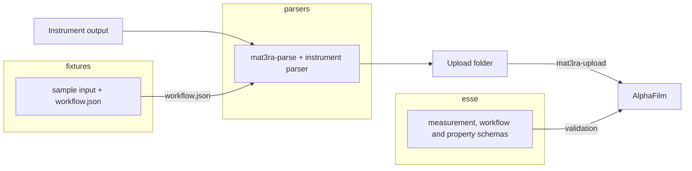

---
tags:
  - alphafilm
  - experimental-data
  - contribution
hide:
  - tags
render_macros: true
---

# Contribute Experimental Data Types to AlphaFilm

This page describes how a new instrument, or a new type of result, is added to AlphaFilm, so that the commands of
[Upload Experimental Data](upload-experimental-data.md) work for it. The work is a pull request to each of the
repositories `esse`, `fixtures` and `parsers`. It needs a GitHub account, git, git-lfs, Python 3.10 or newer, and
[Node.js](https://nodejs.org) for the schema tests.


## 1. Overview

[**esse**](https://github.com/mat3ra/esse) holds the JSON schemas that the platform validates uploaded measurements
and properties against. [**fixtures**](https://github.com/mat3ra/fixtures) holds, for each instrument, a sample of its
output as delivered and the workflow document of its measurements. [**parsers**](https://github.com/mat3ra/parsers)
holds one parser per instrument and the `mat3ra-parse` command, which writes the folder that `mat3ra-upload` takes.



Laboratories install the commands from api-examples, as in
[Upload Experimental Data](upload-experimental-data.md#31-install-the-commands). Its `alphafilm` extra installs
api-client, parsers and fixtures from their `alphafilm` branches. The pull requests are merged in order, esse first,
fixtures second and parsers last.


## 2. Add a property type to `esse`

This section is needed only for a new property type.

### 2.1. Clone the repository

Clone the `alphafilm` branch:

```bash
git clone -b alphafilm https://github.com/mat3ra/esse.git
```

### 2.2. Add the schema and register it

Add the schema of the type under `schema/properties_directory/` and its example at the same path under `example/`.
Add an entry for the type to `manifest/properties.yaml`, its name to `schema/properties_directory/enum_options.json`,
and a reference to its schema in `schema/property/holder.json`. The `hysteresis_loop` type is registered in the same
places. esse's guide [Contributing a schema]({{ schemas_url }}/docs/contributing-a-schema.html) describes a new
property step by step.

### 2.3. Regenerate the models and update the counts

Regenerate the Python models under `src/py/mat3ra/esse/` and commit them with the schema. The new schema changes the
entity-graph counts in `tests/js/entityGraph.tests.ts`. Update them in the same commit.

### 2.4. Run the tests

`npm test` builds and lints the schemas, then runs the tests:

```bash
npm install
npm test
```

### 2.5. Publish a work-in-progress build

Push a commit whose message contains `[release]`. A work-in-progress (WIP) tarball is then published under the release
tag `wip-<short commit hash>`. AlphaFilm accepts the new property type once it is redeployed with that tarball.

### 2.6. Open the pull request

Open the pull request against `alphafilm`.


## 3. Add the instrument to `fixtures`

### 3.1. Clone the repository

The delivered inputs and workflow documents under `data/` are stored in Git Large File Storage (LFS). LFS is set up
before the clone:

```bash
git lfs install
git clone -b alphafilm https://github.com/mat3ra/fixtures.git
```

### 3.2. Add the delivered output

Create the folder `data/instruments/<instrument>/<version>/`. `<instrument>` is the instrument's name in its workflow,
with underscores for hyphens, for example `asylum_spm` for `asylum-spm`. Copy a few measurements' worth of the output,
as the instrument delivered it, into a case folder, `case-001` for the first. Name and describe each case in a
`manifest.yml` beside the case folders. The folder of the `asylum-spm` instrument:

```text
data/instruments/asylum_spm/1.0/
├── manifest.yml
└── case-001/
    ├── loops/
    ├── summary.json
    └── workflow.json
```

### 3.3. Write the workflow document

Add the workflow document of the measurements to the case as `workflow.json`, starting from one of the three existing
ones. The document follows the [experimental workflow]({{ schemas_url }}/#schema/workflow/experimental.json) schema.
Name the instrument once, on the subworkflow. Give each unit the type `measurement` and list its results. esse's
`example/workflow/experimental.json` is the workflow of a switching spectroscopy piezoresponse force microscopy
(SS-PFM) run, here with cuts marked `"...": "..."`:

```json
{
    "name": "SS-PFM Hysteresis Loop",
    "subworkflows": [
        {
            "name": "ss_pfm",
            "instrument": {
                "name": "asylum-spm",
                "shortName": "spm",
                "summary": "Asylum Research SPM driven by afm-lib (switching-spectroscopy PFM)",
                "version": "1.0"
            },
            "properties": [
                "hysteresis_loop"
            ],
            "units": [
                {
                    "type": "measurement",
                    "name": "run_loop",
                    "head": true,
                    "results": [
                        {
                            "name": "hysteresis_loop"
                        }
                    ],
                    "...": "..."
                }
            ],
            "...": "..."
        }
    ],
    "units": [
        {
            "type": "subworkflow",
            "name": "ss_pfm",
            "...": "..."
        }
    ],
    "properties": [
        "hysteresis_loop"
    ],
    "tags": [
        "experimental",
        "afm"
    ],
    "...": "..."
}
```

### 3.4. Register the files in the package manifest

Register the files in `src/py/mat3ra/fixtures/manifest.yml`, each under a key. The reference path of a file is then
`instruments/<instrument>/v<version>/<key>`. `mat3ra-parse` reads the workflow at
`instruments/<instrument>/v1.0/workflow`:

```yaml
instruments:
  asylum_spm:
    v1.0:
      workflow: /data/instruments/asylum_spm/1.0/case-001/workflow.json
      summary: /data/instruments/asylum_spm/1.0/case-001/summary.json
```

### 3.5. Open the pull request

Open the pull request against `alphafilm`.


## 4. Add the parser to `parsers`

### 4.1. Clone the repository

Clone the `alphafilm` branch:

```bash
git clone -b alphafilm https://github.com/mat3ra/parsers.git
```

### 4.2. Write the parser

Create `src/py/mat3ra/parsers/instruments/<instrument>/parser.py` with a `BaseParser` subclass. Its constructor takes
the path of the delivered input and the workflow document. Its `parse()` returns the set's document, one document per
measurement, and the files of each measurement. A file is given as a path to copy or as the lines to write.
`MeasurementSetParser` in `src/py/mat3ra/parsers/entities/measurement_set.py` writes the folder from them. It also
adds the content of a `sample.json` in the input folder, or beside an input file, to every sample's `metadata`.

The parser decides what one measurement is, for example one pad. It gives each measurement one sample, with a name
and the sample's position in `metadata`. It copies the workflow document into every measurement and adds the run's
point pattern, when the run has one, to the workflow's `metadata`. The instrument's record of the run, such as its
settings, goes into `setup`. A result goes into `properties` when esse defines its type (section 2). Other results
stay in the files. Each measurement gets only its own files, copied as delivered. A measurement from a table gets the
table's header and its own row.

### 4.3. Register it in the factory

Add a line to `src/py/mat3ra/parsers/factory.py` that registers the parser under `instruments.<instrument>`. For an
instrument that its workflow names `my-instrument`, the line is:

```python
"instruments.my_instrument": "mat3ra.parsers.instruments.my_instrument.parser.MyInstrumentParser",
```

`mat3ra-parse my-instrument RUN upload` then reads the workflow at `instruments/my_instrument/v1.0/workflow` in
fixtures. It takes the instrument's name from the workflow and runs the parser registered under that name, with
underscores for hyphens.

### 4.4. Test against the fixture and esse

Add a test to `tests/py/unit/` like the existing ones. It parses the fixture's input with its workflow, compares the
result with the expected measurements and files, and validates each measurement against esse's `measurement` schema.
Install the `tests` extra, which brings esse and fixtures from their `alphafilm` branches, and run the tests:

```bash
pip install ".[tests]"
pytest tests/py/unit -q
```

Until the fixtures pull request is merged, run `pip install ../fixtures` after the first command. The local fixtures
checkout then takes the place of the `alphafilm` one.

### 4.5. Open the pull request

Open the pull request against `alphafilm`.


## 5. Reinstall the commands and parse a run

After the pull requests are merged, reinstall the commands with `--force-reinstall`, which brings the new parser and
fixtures. Then parse a run of the new instrument, `RUN` here, into a new folder, `upload`:

```bash
pip install --force-reinstall "mat3ra-notebooks-utils[alphafilm] @ git+https://github.com/mat3ra/api-examples.git@alphafilm"
mat3ra-parse <instrument> RUN upload
```

The folder is uploaded with `mat3ra-upload` as in
[Upload Experimental Data](upload-experimental-data.md#34-upload-the-folder).


## 6. References

The documents and repositories this page refers to:

- Usage: [Upload Experimental Data](upload-experimental-data.md)
- Schemas: the [schema explorer]({{ schemas_url }}/) and esse's
  [Contributing a schema]({{ schemas_url }}/docs/contributing-a-schema.html)
- Schema repository: [github.com/mat3ra/esse](https://github.com/mat3ra/esse/tree/alphafilm)
- Sample data repository: [github.com/mat3ra/fixtures](https://github.com/mat3ra/fixtures/tree/alphafilm)
- Parser repository: [github.com/mat3ra/parsers](https://github.com/mat3ra/parsers/tree/alphafilm)
- Sign-in and upload commands: [github.com/mat3ra/api-client](https://github.com/mat3ra/api-client/tree/alphafilm)
