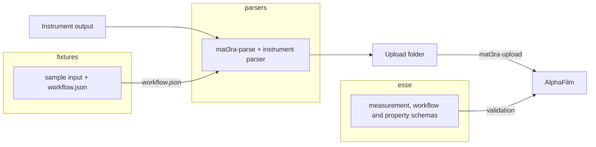

---
tags:
  - alphafilm
  - experimental-data
  - contribution
hide:
  - tags
render_macros: true
---

# Contribute Experimental Data Types to AlphaFilm

This page explains how a new instrument, or a new type of result, is added to AlphaFilm, so that the commands of
[Upload Experimental Data](upload-experimental-data.md) work for it unchanged. The work is one pull request (PR) to
each of the repositories `esse`, `fixtures` and `parsers` that needs a change. A GitHub account, git, git-lfs, Python
3.10 or newer, and [Node.js](https://nodejs.org) for the schema tests are required.


## 1. Overview

### 1.1. Understand the three repositories

[**esse**](https://github.com/mat3ra/esse) holds the JSON schemas of the records: the measurement, the sample, the
experimental workflow and the property types. The platform validates uploaded measurements and properties against
them.

[**fixtures**](https://github.com/mat3ra/fixtures) holds, for each instrument, a sample of its output as delivered and
the workflow document of its measurements.

[**parsers**](https://github.com/mat3ra/parsers) holds one parser per instrument and the `mat3ra-parse` command. The
command reads the instrument's workflow document from fixtures, runs the parser, and writes the folder that
`mat3ra-upload` takes.



### 1.2. Understand the workflow document

Every measurement carries a workflow document: what was measured, with which instrument, and with which results. It
follows the [experimental workflow]({{ schemas_url }}/#schema/workflow/experimental.json) schema: the instrument is
named once, on the subworkflow; the units are of type `measurement` and list their results; there is no model, method
or compute. esse's `example/workflow/experimental.json` is the workflow of a switching spectroscopy piezoresponse
force microscopy (SS-PFM) run, here with cuts marked `"...": "..."`:

```json
{
    "name": "SS-PFM Hysteresis Loop",
    "subworkflows": [
        {
            "name": "ss_pfm",
            "instrument": {
                "name": "asylum-spm",
                "shortName": "spm",
                "summary": "Asylum Research SPM driven by afm-lib (switching-spectroscopy PFM)",
                "version": "1.0"
            },
            "properties": [
                "hysteresis_loop"
            ],
            "units": [
                {
                    "type": "measurement",
                    "name": "run_loop",
                    "head": true,
                    "results": [
                        {
                            "name": "hysteresis_loop"
                        }
                    ],
                    "...": "..."
                }
            ],
            "...": "..."
        }
    ],
    "units": [
        {
            "type": "subworkflow",
            "name": "ss_pfm",
            "...": "..."
        }
    ],
    "properties": [
        "hysteresis_loop"
    ],
    "tags": [
        "experimental",
        "afm"
    ],
    "...": "..."
}
```

The workflow document of each instrument lives in fixtures, beside its sample input, and `mat3ra-parse` copies it into
every measurement it writes. The instrument's name in it is how `mat3ra-parse` finds the parser (section 4.3).

### 1.3. Work on the branch `alphafilm`

Each of the three repositories has a branch `alphafilm`, and so has api-client, which provides `mat3ra-auth` and
`mat3ra-upload`. The installation command reads parsers from its `alphafilm` branch, and the `alphafilm` extra of
parsers installs fixtures and api-client from theirs; the tests of parsers read esse and fixtures from theirs. Each
pull request below is opened against `alphafilm`.


## 2. `esse` repository

### 2.1. Clone the repository

The work starts from the repository's `alphafilm` branch:

```bash
git clone -b alphafilm https://github.com/mat3ra/esse.git
```

### 2.2. Check the experimental workflow schemas

A new instrument needs no schema change: its name is a value in the workflow document. The workflow schemas change only
when a technique needs a field they lack:

- `schema/workflow/experimental.json` → the workflow: name, description, metadata, tags, `properties`, `subworkflows`
  and `units`.
- `schema/workflow/experimental/subworkflow.json` → a subworkflow: `properties`, `instrument` and `units`.
- `schema/workflow/experimental/unit.json` → a unit of type `measurement`, with the `results` it gives.
- `schema/workflow/experimental/instrument.json` → the instrument: `name`, which is required, `shortName`, `summary`
  and `version`.

`schema/measurement.json` takes its `workflow` from `schema/workflow/experimental.json`, and
`example/workflow/experimental.json` is the workflow quoted in section 1.2; `example/` mirrors `schema/`, and an
example is optional.

### 2.3. Add a property type

A result becomes a property only when esse defines its type; otherwise it stays in the measurement's files. A new type
is a schema under `schema/properties_directory/`, with an example at the same path under `example/`. `hysteresis_loop`
shows each place a type is registered: its schema and example, an entry in `manifest/properties.yaml`, its name in
`schema/properties_directory/enum_options.json`, and a reference in `schema/property/holder.json`. The esse page
[Contributing a schema]({{ schemas_url }}/docs/contributing-a-schema.html) walks through a new property step by step;
its pull request goes against `dev`, the one here against `alphafilm`.

### 2.4. Test and publish

`npm test` builds the schemas, lints them and runs the tests:

```bash
npm install
npm test
```

A commit whose message contains `[release]` publishes a work-in-progress (WIP) tarball under the release tag
`wip-<short commit hash>`. AlphaFilm accepts a new property type once it is redeployed with that tarball.


## 3. `fixtures` repository

### 3.1. Clone the repository

Files under `data/` are stored in Git Large File Storage (LFS), so `git lfs install` comes before cloning:

```bash
git lfs install
git clone -b alphafilm https://github.com/mat3ra/fixtures.git
```

### 3.2. Add the delivered input and its workflow

Each instrument has a folder `data/instruments/<instrument>/<version>/`, named as the workflow names the instrument,
with underscores for hyphens: `asylum_spm` for `asylum-spm`. A case, `case-001` first, holds a sample of the output as
the instrument delivered it, a few measurements' worth, and the `workflow.json` of its measurements. `manifest.yml`
beside the cases names and describes each one:

```text
data/instruments/asylum_spm/1.0/
├── manifest.yml
└── case-001/
    ├── loops/
    ├── summary.json
    └── workflow.json
```

The three existing `workflow.json` files are the starting point for a new one.

### 3.3. Register the files in the package manifest

`src/py/mat3ra/fixtures/manifest.yml` gives each file a reference path, `instruments/<instrument>/v<version>/<key>`.
`mat3ra-parse` reads the workflow at `instruments/<instrument>/v1.0/workflow`; `v1.0` is the version it reads today:

```yaml
instruments:
  asylum_spm:
    v1.0:
      workflow: /data/instruments/asylum_spm/1.0/case-001/workflow.json
      summary: /data/instruments/asylum_spm/1.0/case-001/summary.json
```


## 4. `parsers` repository

### 4.1. Clone the repository

The work starts from the repository's `alphafilm` branch:

```bash
git clone -b alphafilm https://github.com/mat3ra/parsers.git
```

### 4.2. Write the parser

A parser reads a run as the instrument wrote it and returns what goes into the folder. It is a `BaseParser` subclass
in `src/py/mat3ra/parsers/instruments/<instrument>/parser.py`, constructed with the path of the delivered input and
the workflow document. Its `parse()` returns the set's document, one document per measurement and the files of each;
`MeasurementSetParser` in `src/py/mat3ra/parsers/entities/measurement_set.py` writes them as the folder.

A parser:

- decides what one measurement is, one pad, one site or one row, and names its sample: a measurement has one sample
- puts the instrument's own record of the session and its settings into `setup`
- copies the delivered files under `files/`, as they are
- writes a property only for a type esse defines (section 2.3)
- leaves results without a type in the files, rather than transcribing them into JSON
- keeps `metadata` for context: positions, labels and the size of a pad
- puts the workflow document into every measurement

### 4.3. Register it in the factory

One line in `src/py/mat3ra/parsers/factory.py` registers the parser under `instruments.<instrument>`, here for an
instrument that its workflow names `my-instrument`:

```python
"instruments.my_instrument": "mat3ra.parsers.instruments.my_instrument.parser.MyInstrumentParser",
```

`mat3ra-parse my-instrument RUN upload` then reads the workflow at `instruments/my_instrument/v1.0/workflow` in
fixtures, takes the instrument's name from it, and runs the parser registered under that name, with underscores for
hyphens.

### 4.4. Test against the fixture and esse

A test in `tests/py/unit/` parses the fixture's input with its workflow, compares the result with the expected
measurements and files, and validates each measurement against esse's `measurement` schema, as the existing tests do.
The `tests` extra installs esse and fixtures from their `alphafilm` branches, and the tests run as in continuous
integration (CI):

```bash
pip install ".[tests]"
pytest tests/py/unit -q
```

A fixture not yet merged is tested by running `pip install ../fixtures` after the first command, which puts the local
fixtures checkout in place of the `alphafilm` one.


## 5. Merge order and checklist

The order follows what each repository reads from the others: esse first, since the platform and the parser's test
validate against its schemas; fixtures second, since the parser's test and `mat3ra-parse` read the input and the
workflow from it; parsers last. A repository with nothing to change is skipped: an instrument whose results have no
new property type needs no esse change.

### 5.1. `esse` checklist

  ✅ property schema under `schema/properties_directory/` and its example under `example/` <br/>
  ✅ entries in `manifest/properties.yaml`, `schema/properties_directory/enum_options.json` and
  `schema/property/holder.json` <br/>
  ✅ regenerated models under `src/py/mat3ra/esse/` committed <br/>
  ✅ entity-graph counts in `tests/js/entityGraph.tests.ts` updated <br/>
  ✅ `npm test` passes <br/>
  ✅ `[release]` commit pushed, WIP tarball published <br/>
  ✅ Merged into `alphafilm` first

### 5.2. `fixtures` checklist

  ✅ delivered input and `workflow.json` under `data/instruments/<instrument>/<version>/case-001/` <br/>
  ✅ `manifest.yml` beside the cases <br/>
  ✅ references under `instruments/<instrument>/v1.0/` in `src/py/mat3ra/fixtures/manifest.yml` <br/>
  ✅ files stored in Git LFS <br/>
  ✅ Merged after the esse pull request

### 5.3. `parsers` checklist

  ✅ `BaseParser` subclass in `src/py/mat3ra/parsers/instruments/<instrument>/parser.py` <br/>
  ✅ one line in `src/py/mat3ra/parsers/factory.py`, keyed `instruments.<instrument>` <br/>
  ✅ test reading the fixture and validating against esse <br/>
  ✅ `pytest tests/py/unit -q` passes <br/>
  ✅ Merged last

The installation command of [Upload Experimental Data](upload-experimental-data.md#31-install-the-commands), run with
`--force-reinstall` after the three merges, brings the new parser, and `mat3ra-parse <instrument> RUN upload` writes a
folder that `mat3ra-upload` takes as before.


## 6. References

The documents and repositories this page refers to:

- Usage: [Upload Experimental Data](upload-experimental-data.md)
- Schemas: the [schema explorer]({{ schemas_url }}/) and esse's
  [Contributing a schema]({{ schemas_url }}/docs/contributing-a-schema.html)
- Schema repository: [github.com/mat3ra/esse](https://github.com/mat3ra/esse/tree/alphafilm)
- Sample data repository: [github.com/mat3ra/fixtures](https://github.com/mat3ra/fixtures/tree/alphafilm)
- Parser repository: [github.com/mat3ra/parsers](https://github.com/mat3ra/parsers/tree/alphafilm)
- Sign-in and upload commands: [github.com/mat3ra/api-client](https://github.com/mat3ra/api-client/tree/alphafilm)
